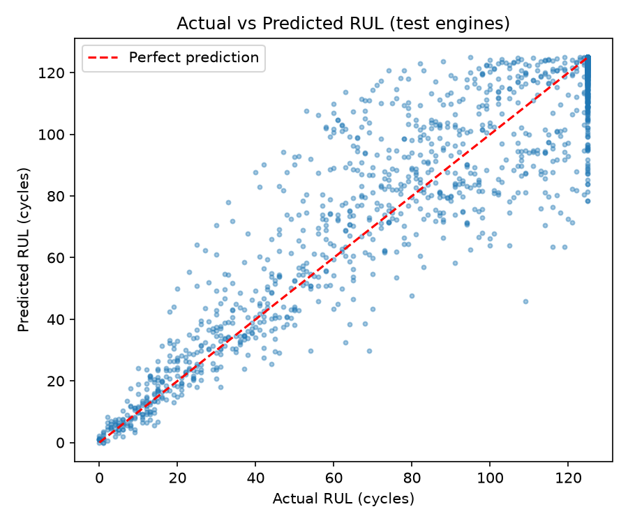
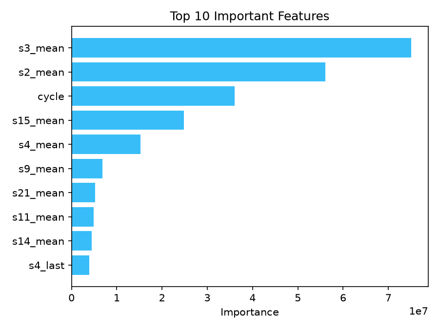

# Predictive Maintenance Dashboard


A beginner-friendly predictive maintenance project that predicts
**how many cycles a machine can still run before it fails** — its
**Remaining Useful Life (RUL)** — using NASA's C-MAPSS turbofan
engine dataset.

> **Live demo:** After deploying (see [Deploy the dashboard](#deploy-the-dashboard-streamlit-cloud) below), put your Streamlit Cloud link here so visitors can try the dashboard without installing anything. Until then, the dashboard shows built-in sample data, and the full live system runs locally or with Docker.

---

## The problem

Machines that fail without warning cause expensive unplanned
downtime. If we can estimate *how much useful life is left*, a
maintenance team can plan the repair before the failure happens.

This project demonstrates that idea end to end:

```
   NASA data          Training            Prediction API
┌────────────┐     ┌────────────┐      ┌──────────────────┐
│  C-MAPSS   │────▶│  train.py  │─────▶│     api.py       │
│  dataset   │     │  LightGBM  │      │  POST /predict   │
└────────────┘     └────────────┘      └────────▲─────────┘
                                                │ sensor readings
                                       ┌────────┴─────────┐
                                       │  simulator.py    │
                                       │  (live machines) │
                                       └────────┬─────────┘
                                                │ predictions
                                       ┌────────▼─────────┐
                                       │  live_data.db    │
                                       │     SQLite       │
                                       └────────┬─────────┘
                                                │
                                       ┌────────▼─────────┐
                                       │     app.py       │
                                       │    Dashboard     │
                                       └──────────────────┘
```

The simulator plays the role of real machines. In a real factory,
sensors on actual machines would send their readings to the same
API — the rest of the system would not change.

---

## Results

| Model | RMSE (cycles) |
|---|---|
| Baseline (always predict the average RUL) | 41.90 |
| **LightGBM (this project)** | **14.68** |

The LightGBM model is **65% better than the simple baseline**.
In plain words, its prediction is wrong by about 15 cycles on
average, tested on 25 engines the model never saw during training.





More evaluation details are inside the dashboard's
**Model Performance** page, and in the `results/` folder
(`metrics.json`, `evaluation.csv`, `feature_importance.csv`)
created by `train.py`.

---

## Project structure

```
Predictive-Maintenance/
│
├── data/                  # C-MAPSS txt files (downloaded by train.py)
├── train.py               # Train LightGBM → model.pkl + results/
├── features.py            # ONE shared feature function (training + live)
├── simulator.py           # Replay engines → ask API → save to SQLite
├── api.py                 # FastAPI: POST /predict → RUL, health, status
├── app.py                 # Streamlit: Fleet + Machine + Model pages
├── tests/
│   └── test_features.py   # Simple tests for the feature code
├── assets/                # Result charts + sample data for the demo
├── results/               # metrics.json, evaluation.csv, importance
├── Dockerfile             # One image for all services
├── docker-compose.yml     # Run everything with one command
├── requirements.txt       # Pinned package versions
└── README.md
```

Files created when you run the project (not committed to Git):

- `model.pkl` — the trained model, saved by `train.py`
- `live_data.db` — the SQLite database updated by `simulator.py`

---

## How to run

### Option 1: Run locally (recommended for learning)

**1. Install the requirements**

```bash
pip install -r requirements.txt
```

**2. Train the model** (downloads the dataset the first time)

```bash
python train.py
```

**3. Start the prediction API** — Terminal 1

```bash
uvicorn api:app --port 8000
```

Open http://localhost:8000/docs to test the API in your browser.

**4. Start the simulator** — Terminal 2

```bash
python simulator.py --machines 5 --interval 2
```

**5. Start the dashboard** — Terminal 3

```bash
streamlit run app.py
```

Open http://localhost:8501. Tick **Auto-refresh every 3 seconds**
in the sidebar while the simulator is running.

To stop the simulator, press `Ctrl+C`.

### Option 2: Run with Docker (one command)

Train once on your machine so `model.pkl` and `data/` exist, then:

```bash
docker compose up --build
```

- Dashboard: http://localhost:8501
- API docs: http://localhost:8000/docs

Stop with `Ctrl+C` or `docker compose down`.

### Run the tests

```bash
pytest
```

The tests build a tiny fake dataset, so they finish in seconds and
do not need the real data. The most important test checks that the
live feature row used by the API has exactly the same columns, in
the same order, as the features used in training.

---

## Deploy the dashboard (Streamlit Cloud)

1. Push this project to your GitHub.
2. Go to [share.streamlit.io](https://share.streamlit.io) and sign
   in with GitHub.
3. Create a new app pointing to `app.py` in your repository.
4. Deploy. The public app shows the sample data from
   `assets/sample_data.csv` so visitors can explore all dashboard
   pages. (The live simulator and API still run locally or with
   Docker, because Streamlit Cloud only hosts the dashboard.)
5. Paste your live link at the top of this README and on your
   resume.

---

## How it works, step by step

### 1. The data

Each row of `train_FD001.txt` is one cycle of one engine:

```
unit | cycle | op1 op2 op3 | s1 s2 ... s21
```

The training file has **100 engines and 20,631 cycles**. Every
engine was run until it failed, so we know its full life.

### 2. The label: Remaining Useful Life

If an engine lived for 200 cycles, then at cycle 150 its RUL is 50,
and at cycle 200 its RUL is 0.

RUL is **capped at 125**: early in life there is almost no visible
wear, so instead of teaching the model an exact number like 180,
we teach it "more than 125", which simply means healthy.

### 3. The features: last 20 cycles (features.py)

The model does not look at only the current sensor reading. For
each of **14 useful sensors**, the last 20 cycles become:

| Feature | Simple meaning |
|---|---|
| `_last` | Current sensor value |
| `_mean` | Average value in the last 20 cycles |
| `_std` | How much the value moved up and down |
| `_trend` | Current value minus the value 20 cycles ago |

That is `14 × 4 + cycle = 57 features`. Only 14 of the 21 sensors
are used because the others are almost constant in FD001.

`features.py` is shared by training and live prediction. This is a
deliberate design decision: if the two created features differently,
the model would get different inputs in real use and its predictions
would quietly become unreliable.

### 4. The model: LightGBM

LightGBM is a gradient boosting model: it builds many small
decision trees one after another, each new tree fixing the mistakes
of the trees before it. It works well on tabular data like sensor
readings and trains in a few seconds.

**The split is by engine, not by random rows** — 75 engines train
the model, 25 different engines test it. Cycles from the same
engine look very similar; a random row split would let the model
"cheat" and produce a misleading score.

### 5. The API: api.py

FastAPI loads the trained model once at startup and exposes:

| Endpoint | What it does |
|---|---|
| `GET /health` | Checks the API is running and the model is loaded |
| `POST /predict` | Send the last 20 readings of a machine → get back RUL, health %, and status |

Keeping the model behind an API means any application can use it
without knowing machine learning — the same reason real companies
separate their ML models into services.

### 6. The simulator: simulator.py

There are no real live machines here, so the simulator replays
dataset engines slowly, like live data:

1. Machine-1…Machine-5 each follow one engine, starting at a
   different point in its life.
2. Every 2 seconds, each machine sends its last 20 cycles to the
   API and receives a predicted RUL.
3. The reading and prediction are saved to `live_data.db`.

When a machine reaches the end of its engine's life, it restarts
from the beginning — as if the machine was repaired.

### 7. The dashboard: app.py

**Fleet Overview** — all machines, Healthy/Warning/Critical counts,
a table sorted by lowest RUL, and a comparison bar chart.

**Machine Detail** — one machine's status, RUL, health, and cycle;
charts of RUL over time and selectable sensor trends.

**Model Performance** — LightGBM vs baseline RMSE, Actual vs
Predicted chart, and the most important features, so anyone can
judge whether the model is actually good.

Simple status rules used everywhere:

| Status | Rule | Meaning |
|---|---|---|
| Healthy | RUL > 50 cycles | No action needed |
| Warning | RUL 20–50 cycles | Watch closely, plan maintenance |
| Critical | RUL < 20 cycles | Plan maintenance now |

Health percentage is also simple: `Health % = (RUL / 125) × 100`.

---

## How to explain this project in an interview

> "NASA's C-MAPSS dataset contains turbofan engines with 21
> sensors, run until failure; each row is one cycle. I created the
> label Remaining Useful Life and capped it at 125 because early
> wear is invisible. For features, I used the last 20 cycles of 14
> useful sensors — last value, mean, standard deviation, and trend
> — kept in one shared module so training and live prediction can
> never differ. I trained a LightGBM model, splitting by engine so
> the test engines were never seen in training. It achieved an RMSE
> of about 14.7 cycles, 65% better than a predict-the-average
> baseline. I then served the model with a FastAPI endpoint, built
> a simulator that replays engines like live machines calling that
> API, stored predictions in SQLite, and showed everything in a
> three-page Streamlit dashboard. The whole system also runs with
> one Docker Compose command, and I have small pytest tests
> covering the feature logic."

Follow-up answers worth preparing:

- **Why LightGBM, not deep learning?** The data is tabular and not
  huge; tree models are strong here, train in seconds, and their
  important features are easy to show and explain.
- **Why an API instead of loading the model in the dashboard?**
  Separation of concerns — the model becomes a reusable service,
  like in real company systems.
- **Why SQLite?** It is one file, needs no server setup, and is
  enough for this scale. A bigger system would move to a server
  database.
- **How would this work in a real company?** Real machine sensors
  would replace the simulator and send readings to the same API;
  the model, database, and dashboard ideas stay the same, hosted
  on cloud servers with alerts to the maintenance team.

---

## Limitations (be honest about these)

- The data is **simulated** turbofan data (FD001: one operating
  condition, one fault type), not real factory telemetry.
- The Healthy/Warning/Critical limits are simple fixed rules.
- The prediction is one number; it does not show a range of
  uncertainty.
- The public Streamlit demo shows sample data; the fully live
  system (API + simulator) runs locally or with Docker.

Sensible future improvements, one at a time: an anomaly detector
for unusual behaviour, prediction ranges, a maintenance schedule
page, user login, and cloud hosting for the API.

---

## Dataset credit

A. Saxena and K. Goebel, *Turbofan Engine Degradation Simulation
Data Set*, NASA Prognostics Data Repository, NASA Ames Research
Center, 2008. The dataset is downloaded by `train.py` and is not
committed to this repository.
